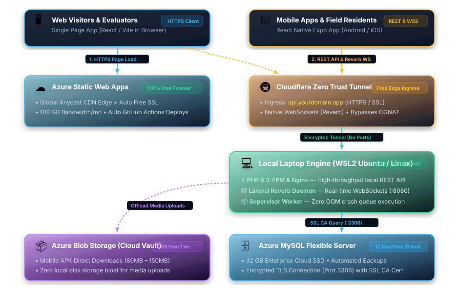

# Azure Student & Free Tier Deployment Guide
**Running Production Full-Stack Projects When `Standard_B1s` is Unavailable**

---

## 1. Executive Summary & The Problem

When developing capstone, thesis, or commercial projects using Microsoft Azure's **Azure for Students** or **Standard Free Account**:
- **Azure for Students** provides a **$100 USD credit valid for 1 full year (12 months)** with no credit card required. (By contrast, the **Standard Azure Free Account** gives a **$200 USD credit valid for only 1 month / 30 days** and requires card verification).
- Alongside your credits, you are entitled to **12 Months of Free Services** and **65+ Always-Free Services**.
- Traditionally, developers rely on the **`Standard_B1s`** Linux Virtual Machine (750 hours/month free).

### The "B1s Unavailable" Bottleneck
In many regional datacenters—especially in the Asia-Pacific region (`eastasia` / Hong Kong, `southeastasia` / Singapore, `japaneast`):
1. **Capacity Depletion:** `Standard_B1s` instances are frequently grayed out or marked *"Size not available in this region"* due to high global demand.
2. **Quota Restrictions:** Student subscriptions often have their vCPU quota limit set to `0` for the specific classic `Standard BS Family`.
3. **Portal Pricing Confusion:** The Azure Portal VM size selector displays the gross retail price (e.g. `~$10.40/month`) instead of `$0.00`. (Azure applies the 750 free hours credit on your monthly invoice rather than showing zero in the catalog).
4. **Memory Constraint:** Even when available, `B1s` offers only **1 GiB of RAM**, which struggles to support modern multi-service stacks (e.g., Nginx + PHP 8.3-FPM + MySQL + Laravel Reverb WebSockets + Queue Workers).

---

## 2. Cloud Alternative: Newer 12-Month Free VM Sizes

If you require a 100% cloud-hosted VM, Microsoft officially expanded the 12-month free compute tier beyond `Standard_B1s` to include:

| VM Size | Processor Architecture | vCPUs | RAM | 12-Month Free Quota |
|---|---|---|---|---|
| **`Standard_B2ats_v2`** | AMD EPYC 7763v (x86_64) | 2 | 1 GiB | 750 hours / month |
| **`Standard_B2pts_v2`** | Ampere Altra (ARM64) | 2 | 1 GiB | 750 hours / month |
| **`Standard_B1s`** | Intel Xeon (x86_64) | 1 | 1 GiB | 750 hours / month |

> [!TIP]
> If `B1s` is unavailable in your selected region, search for **`B2ats_v2`** (AMD) in the VM size picker. It provides 2 burstable vCPUs instead of 1, while qualifying for the same 750 hours/month free tier.

---

## 3. The Recommended Alternative: The Hybrid Architecture

If cloud VM capacity is exhausted or you need more than 1 GiB of RAM without paying cloud fees, use the **Hybrid Architecture**:
> **"Laptop as Engine (CPU/RAM) + Azure as Vault (Storage/Database/CDN)"**

### Visual Flowchart Diagram


> [!TIP]
> 🔗 **Open & Download in Mermaid Live Editor:**  
> [👉 Click here to view, customize, and export this flowchart as PNG / SVG in Mermaid Live](https://mermaid.live/edit#pako:eNqVVn9v2kgQ_SojpDsRXUNsSCJanSoZyC8VEjcmjXTH6bS2B1jV7Fq7a4iv9LvfrNc0NmorNX-gsDs782bmzRu-dBKZYucddJaZ3CVrpgzMJwsB9KeLeKVYvoZxxlEY_feisyjS4SChz6XvHY7hd3jSqPSi8497Z_-eMT6Yp_SZsotFsURvaS_gE9fcSGVfXm1ZVjD75c9Ynb3vPiJLDJyRiUGIuFhlCCFbIQR5ftKKMJMxz7AZJFn69am1tt6vOWYpPKLmqUXaDHHPDN8iXL3kksIFIlWSpxCEH16joEgX4qgUV-nKxexfen6dkj2DCWbkT5UU9U6sFGoNU1aiamGOnoP6MfMh-K9QlKMhIElVFgvaQQyyHSs1XCtEmHNUJ9UxvfP6fbjJZMwyglwmTBsYT-4rBE2ToDDSwYqiKYxRGb7kCTOom1a-58HNCEZMpDuemjXVYSOFWbcgzwshMGuWGfGQ-DiTxISMURp_oZIwVwUBci9cIhTiN5fGtVS4PcrkgPAdsJz3SlmoVG4YFz2W5027uldUo0gmn9FAqKSRicyIGlqbtZLFat18MCpzukANd1EI45v7YF6RQeGOZZn-aYOnMmHZlVhx0eZWHLsr6mpuZA7OBLrP0bQPT3EhTEH1m1h8qk3UezJ8OZ6d6pCYSSXRaPN5KaEbSpq-oXd2fj5ouwhvw5o3b9_WtacjGPYGp9fhjDpIUYVl712bbkWOasu1VK1Z9M4bNzZ2Ytk6Y4LmrM3XCl_8StkpU2yLWX1OyR86oqHGPvTayD8WWLQLiZff3FSX8CwV1QwmDIl9bRWpKh7lmLQ8MAZDS1zbbH8A_iV9-aPuzmMwg25FxoeHGYwV02vUbUhHnYHT0_e2mt8rW3Xnkv3hdZXEj_lUTfknVmSmRYE0rvvoVKCaJKjMoOv3ScZoDp0AHKleGX2ctrqZnLc8VQZwneELj0kII4KKqjkbJDgiZSr9d-RvNAWD7ZhG8w2QsPCRrV9rRAd9W-lbvlqfUh8wrZFG0aQ1yCJRZW7oej6Nah4PBt7lCY3dhPGsrCha5O3ujkjIjqnhkrA3BFQqq_zdCwuhKkUz5kHpww8w4oIpTuPeHXqzkaOFf0H_th7YJQVPeSZZanfDDFPOICCZMN9VBKvI1N-934Pb-TyM3Bqa0uu91fGGUY-s-j14vIrmdgTJ9-tc7Gs5dOY1Zuv2F6yt_4ncCYu8le--KtQBsHtaOX_tx0NhYlmQNtS33XvpRpX0eEcsoA17sneD4LxYXbEu7OJ4dUMkV2WzsXtHtMabCiVJLO1WV1pXagh5TqtR4AHsN1WowgS6FAlMRrQ7mNC0mDlpQO288wY6G1S0EVL6gfKlY9a4qX6qEH0_d77SLaM9F5EDOjSqIBJ3ijylNTfhjKZvUx9__R8r-My_)

### Native GitHub Mermaid Flowchart
```mermaid
flowchart TD
    subgraph Clients["🌐 Clients & Users"]
        Web["🖥️ Web Visitors & Evaluators<br/>(React / Vite Single Page App)"]
        Mobile["📱 Mobile Apps & Residents<br/>(React Native Expo / Android APK)"]
    end

    subgraph Edge["☁️ Edge Delivery & Ingress Layer"]
        SWA["⚡ Azure Static Web Apps<br/>(Always Free Tier)<br/>• Global Anycast CDN Edge<br/>• Auto Edge SSL Certificates<br/>• 100 GB Bandwidth/month"]
        Tunnel["🛡️ Cloudflare Zero Trust Tunnel<br/>(100% Free Forever)<br/>• Edge SSL: api.yourdomain.app<br/>• Native WebSocket Protocol Passthrough<br/>• Bypasses ISP CGNAT & Firewalls"]
    end

    subgraph LocalEngine["💻 Local Laptop Engine (WSL2 Ubuntu / Docker)"]
        Nginx["🌐 Nginx Reverse Proxy (Port 80/443)"]
        PHP["⚙️ PHP 8.3-FPM Backend API"]
        Supervisor["🔄 Supervisor Process Manager"]
        Reverb["⚡ Laravel Reverb (WebSockets Port 8080)"]
        Queue["📦 Laravel Queue Worker Daemons"]
        LocalSpec["💪 8 GB – 16 GB+ Local RAM (Zero OOM Crashes)"]
        
        Nginx --> PHP
        Supervisor --> Reverb
        Supervisor --> Queue
    end

    subgraph AzureVault["🏛️ Azure Cloud Vault (12 Months Free)"]
        MySQL["🗄️ Azure MySQL Flexible Server<br/>• Standard_B1ms (1 vCore, 2 GiB RAM)<br/>• 32 GB High-Speed Cloud SSD<br/>• Encrypted TLS (Port 3306) & Daily Backups"]
        Blob["📦 Azure Blob Storage (5 GB Free)<br/>• Mobile APK Binaries (80MB–150MB)<br/>• User Uploads & Media Assets"]
    end

    Web -->|1. HTTPS Page Load| SWA
    Web -.->|2. REST API & WebSockets| Tunnel
    Mobile -->|REST API & WebSockets| Tunnel
    Mobile -.->|Download APK Binaries| Blob

    Tunnel -->|Encrypted Outbound WireGuard Tunnel (No Ports)| Nginx
    PHP -->|SSL Encrypted Query (Port 3306)| MySQL
    PHP -.->|Direct Media Upload Pipeline| Blob
    Queue -->|Async DB Transactions| MySQL
```

### ASCII Topology Representation
```
                                      INTERNET / CLIENTS
                         (Mobile Apps, Web Visitors, Teachers, Residents)
                                             |
                +----------------------------+----------------------------+
                |                                                         |
      [Azure Static Web Apps]                                   [Cloudflare Tunnel]
      (Always Free Tier)                                        (100% Free Forever)
      • neoguro.app (React/Vite)                                • api.neoguro.app (HTTPS)
      • evacroute.app (React/Vite)                              • api.evacroute.app (HTTPS)
      • Global CDN Edge + Free SSL                              • WebSocket support (Reverb)
      • 100 GB Bandwidth / Month                                • Works behind any ISP / CGNAT
                |                                                         |
                |                                                         v
                |                                              [Local Laptop / Hardware]
                |                                              (WSL2 Ubuntu / Docker)
                |                                              • PHP 8.3-FPM & Nginx
                |                                              • Laravel Reverb (WebSockets)
                |                                              • Laravel Queue Worker
                |                                              • 8 GB – 16 GB+ Local RAM
                |                                                         |
                +----------------------------+----------------------------+
                                             |
                                             v
                          [Azure Database for MySQL Flexible Server]
                                   (12 Months Free Tier)
                                   • 750 hours/month (B1ms)
                                   • 32 GB High-Speed SSD Storage
                                   • Enterprise Backups & Cloud Redundancy
```

---

## 4. Resource Allocation & Zero-Storage-Burden Breakdown

Under this hybrid approach, your local hardware is **not burdened by storage, database bloat, or asset delivery**:

| Responsibility | Resource | Azure Free Allowance | Practical Usage |
|---|---|---|---|
| **Database Storage** | **Azure MySQL Flexible Server** | **32 GB SSD** (12 Mos Free) | Relational tables for users, logs, and messages take < 50 MB total. |
| **Web Frontend Serving** | **Azure Static Web Apps** | **100 GB Bandwidth** (Always Free) | Zero disk consumption locally; globally distributed via Microsoft Edge CDN. |
| **Mobile APKs & Uploads** | **Azure Blob Storage** | **5 GB Storage** + 20k reads (12 Mos) | Large `.apk` binaries (e.g. 79MB and 150MB) and user photos bypass local disk entirely. |
| **Backend Execution** | Local Laptop (WSL2 / Linux) | Unlimited local CPU & RAM | Consumes ~300 MB of local RAM and < 500 MB SSD for raw code repositories. |

---

## 5. Step-by-Step Setup Guide

### Step 1: Provision the Azure Database (MySQL Flexible Server)
1. In the Azure Portal, search for **Azure Database for MySQL flexible servers**.
2. Click **Create** and configure:
   - **Compute tier:** Burstable
   - **Compute size:** `Standard_B1ms` (1 vCore, 2 GiB RAM — eligible for 12 months free).
   - **Storage:** 32 GiB.
3. Under **Networking**:
   - Check **Allow public access from any Azure service within Azure to this server**.
   - Add your local network’s public IP (or allow `0.0.0.0 - 255.255.255.255` with strong password authentication for mobile/remote development).
4. In your Laravel backend `.env`:
   ```env
   DB_CONNECTION=mysql
   DB_HOST=your-server-name.mysql.database.azure.com
   DB_PORT=3306
   DB_DATABASE=your_database_name
   DB_USERNAME=your_admin_user
   DB_PASSWORD=your_secure_password
   MYSQL_ATTR_SSL_CA=/etc/ssl/certs/ca-certificates.crt
   ```

---

### Step 2: Deploy Frontends to Azure Static Web Apps (Free Forever)
1. Push your React / Vite frontend code to GitHub.
2. In the Azure Portal, create an **Azure Static Web App**:
   - **Plan:** Free
   - **Deployment Details:** Link your GitHub repository and branch (`main` or `master`).
   - **Build Preset:** `Vite` (App location: `frontend/AppWeb`, Output location: `dist`).
3. Add your custom domain (e.g., `neoguro.app` or `evacroute.app`) directly inside the Static Web App blade; Azure provisions a free auto-renewing SSL certificate.

---

### Step 3: Run the Backend on Local Hardware (WSL2 Ubuntu)
1. Install PHP 8.3, Composer, and Nginx inside WSL2:
   ```bash
   sudo apt update
   sudo apt install -y php8.3-fpm php8.3-cli php8.3-mysql php8.3-xml php8.3-mbstring php8.3-curl nginx supervisor
   ```
2. Configure `supervisord` to run background workers and WebSockets (such as Laravel Reverb):
   ```ini
   [program:laravel-reverb]
   process_name=%(program_name)s_%(process_num)02d
   command=php /path/to/project/backend/artisan reverb:start
   autostart=true
   autorestart=true
   user=pheinz
   redirect_stderr=true
   stdout_logfile=/var/log/reverb.log
   ```

---

### Step 4: Expose Local APIs Using Cloudflare Tunnels (`cloudflared`)
To make your local backend accessible to mobile devices and the Azure frontend without router port forwarding or public static IP requirements:

1. Install Cloudflare Tunnel on WSL2:
   ```bash
   curl -L --output cloudflared.deb https://github.com/cloudflare/cloudflared/releases/latest/download/cloudflared-linux-amd64.deb
   sudo dpkg -i cloudflared.deb
   ```
2. Authenticate and create a secure tunnel:
   ```bash
   cloudflared tunnel login
   cloudflared tunnel create thesis-tunnel
   ```
3. Map your API domains in your tunnel configuration (`~/.cloudflared/config.yml`):
   ```yaml
   tunnel: <TUNNEL_UUID>
   credentials-file: /home/pheinz/.cloudflared/<TUNNEL_UUID>.json

   ingress:
     - hostname: api.neoguro.app
       service: http://localhost:8000
     - hostname: api.evacroute.app
       service: http://localhost:8001
     - service: http_status:404
   ```
4. Start the tunnel daemon:
   ```bash
   cloudflared tunnel run thesis-tunnel
   ```

> [!NOTE]
> Cloudflare Tunnels natively support WebSockets, pass through CGNAT (common on mobile hotspots, PLDT, Globe, and Converge), and provide automatic edge SSL termination.

---

## 6. Comparison Matrix: VM vs. Hybrid

| Dimension | Single B1s VM (Cloud) | Hybrid Setup (Laptop + Azure) |
|---|---|---|
| **Monthly Cost** | Free for 12 Mos (If B1s in stock) | **$0 Forever** |
| **Compute Power** | 1 vCPU, 1 GB RAM (Tight) | **Multi-core CPU, 8–16+ GB RAM** |
| **WebSocket / Queue Concurrency** | Bottlenecked under load | Smooth, low latency |
| **Database Safety** | Stored on local VM disk | **Enterprise Azure Cloud SSD (32 GB)** |
| **Uptime Requirement** | 24/7 Cloud | Laptop must be running during presentations/testing |
| **Portability** | Static IP on Azure | Fully portable via Cloudflare Tunnel anywhere |

---

## 7. Best Practices for Local Presentation & Defense
- **Prevent Laptop Sleep:** Use Windows PowerToys "Awake" or set Windows sleep mode to "Never" when plugged into power.
- **Automated Backups:** Run automated `mysqldump` jobs from your laptop to Azure Blob Storage or GitHub to ensure zero data loss.
- **Configuration Caching:** Always run `php artisan config:cache` and `php artisan route:cache` in production mode to minimize PHP CPU cycles.
