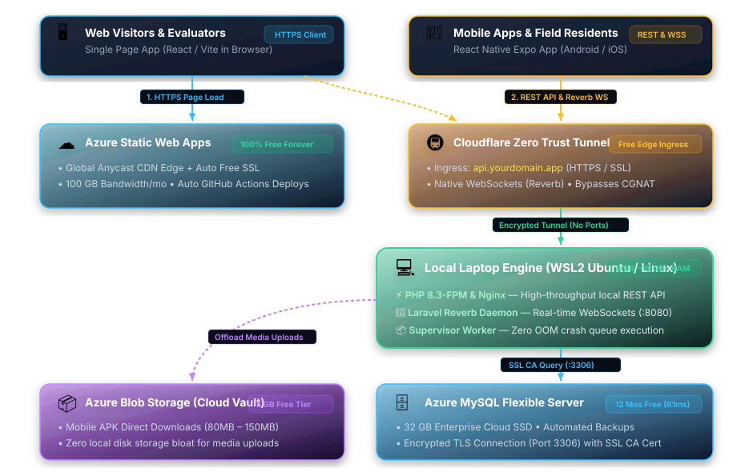

<h1 align="center">Student Cloud & Free Deployment Guide</h1>

<p align="center">
  <b>Stop hitting paywalls and out-of-capacity errors on defense day.</b><br>
  Deploy student demos, full-stack capstones, and hybrid cloud architectures for $0 — from zero-card sandboxes to a 12-month Azure production vault.
</p>

<p align="center">
  <a href="https://azure.microsoft.com/en-us/free/students?WT.mc_id=academic-9938-cxa"></a>
  <a href="https://education.github.com/pack"></a>
  <a href="./Azure-Guide.md"></a>
</p>
<p align="center">
  <sub>Zero-Card Junior Stack (Supabase · Render · Vercel) · 12-Month Azure Capstone Stack · WSL2 + Cloudflare Tunnel Hybrid · Zero build steps</sub>
</p>

<p align="center">
  <a href="LICENSE"></a>
  <a href="https://github.com/Reneilrp/Azure-Guide/stargazers"></a>
</p>

Run the interactive documentation locally with one command:

```sh
git clone https://github.com/Reneilrp/Azure-Guide.git && cd Azure-Guide && python3 -m http.server 8080
```

Zero-config deployment and portal links: [run & deploy](#run--deploy).

## Why

Most cloud tutorials assume you have a credit card, unlimited regional VM quota, and a budget for multi-gigabyte RAM instances. Students don't.

When defense day arrives, `Standard_B1s` is grayed out in Asia-Pacific, 1 GiB VMs crash under Laravel Reverb + Queue workers, free databases pause after 7 days, and ISP CGNAT blocks local port forwarding. This guide replaces trial-and-error with battle-tested deployment tracks tailored for class demos and thesis production systems.

## The deployment tracks

| Track | What you use | What you get |
|---|---|---|
| **1. Rapid Demo (Zero Card)** | **Supabase** + **Render** + **Vercel / Netlify** | Instant PostgreSQL, Node/Python/Go web services, and global CDN hosting using only a GitHub login — zero billing info required |
| **2. 12-Month Cloud (Azure)** | **Azure for Students** (`$100` credit + free tiers) | 750 hrs/mo burstable VMs (`B2ats_v2`, `B2pts_v2`, `B1s`), 32 GB MySQL/PostgreSQL Flexible Server, and 55+ Always-Free services |
| **3. Hybrid Capstone Engine** | **Local WSL2** + **Cloudflare Tunnel** + **Azure Vault** | 8–16+ GB local RAM for heavy backends/WebSockets exposed over HTTPS with zero port forwarding, backed by Azure MySQL & Blob Storage |

All three tracks are documented step by step in [`index.html`](./index.html) and [`Azure-Guide.md`](./Azure-Guide.md), complete with copy-pasteable configs, `.env` templates, and architecture blueprints.

## See it in action



*The Hybrid Architecture ("Laptop as Engine + Azure as Vault") — Static Web Apps and Cloudflare Zero Trust Tunnels at the edge, WSL2 Ubuntu running heavy compute locally, and Azure MySQL Flexible Server + Blob Storage securing data in the cloud.*

| Dimension | Single `Standard_B1s` VM (Cloud) | Hybrid Setup (Laptop + Azure Vault) |
|---|---|---|
| **Monthly Cost** | Free for 12 Mos (if `B1s` is in stock) | **$0 Forever** |
| **Compute Power** | 1 vCPU, 1 GiB RAM (tight, OOM-prone) | **Multi-core CPU, 8–16+ GB local RAM** |
| **WebSocket / Queue Concurrency** | Bottlenecked under load | Smooth, low-latency execution |
| **Database & APK Storage** | Stored on local VM disk | **32 GB Azure Cloud SSD + 5 GB Blob Storage** |
| **Network Portability** | Static IP on Azure | Works behind any ISP, hotspot, or CGNAT |

## Common bottlenecks solved

Look up the exact blocker you hit during setup or right before your presentation.

| Blocker you hit | The fix in this guide |
|---|---|
| `Standard_B1s is grayed out or quota is 0` | Switch region to **East Asia (Hong Kong)** and pick **`Standard_B2ats_v2`** (AMD, 2 vCPUs) or **`Standard_B2pts_v2`** (ARM64, 2 vCPUs) — both qualify for 750 hrs/mo free |
| `Azure card verification fails on MariBank / Maya / GCash` | Keep **₱60 – ₱70 PHP** loaded to cover the temporary **$1.01 USD** authorization hold (refunded immediately) and choose **Azure for Students** ($100 / 1 yr) over the 30-day trial |
| `Render backend freezes for 50s on the first request` | Ping the health endpoint 2 minutes before your panel defense to warm up the container, and bind to `0.0.0.0:$PORT` |
| `Supabase database paused right before demo day` | Trigger the 1-click project restore in the Supabase dashboard at least 30 minutes prior to presentation |
| `CORS policy blocks Vercel frontend from calling API` | Drop in the pre-configured Express (`cors`) or FastAPI (`CORSMiddleware`) snippets from the Junior CORS section |
| `ISP CGNAT (PLDT / Globe / Converge / Hotspot) blocks ports` | Run `cloudflared tunnel` inside WSL2 to expose local Nginx/PHP/WebSocket ports over an outbound encrypted WireGuard tunnel with automatic edge SSL |

## Get started

1. **Pick your track** — use the Zero-Card Decision Matrix for a quick class activity, or the Azure/Hybrid tracks for a year-long thesis.
2. **Browse the interactive guide** — open [`index.html`](./index.html) in any browser and press `/` or `Ctrl+K` to jump straight to a topic.
3. **Provision & verify** — follow the copy-paste commands and set up a **$0.01 Azure Budget Alert** so your debit card is never charged.

## Features

- **zero-card decision matrix** — side-by-side comparison of Render, Supabase, Vercel, Netlify, Neon, and Azure free tiers.
- **12-month Azure playbook** — deep dive into `B2ats_v2` / `B2pts_v2` / `B1s` compute, 2× 64 GB SSDs, MySQL/PostgreSQL Flexible Servers, and regional quota workarounds.
- **hybrid WSL2 + Cloudflare blueprint** — production supervisor configs for PHP 8.3-FPM, Laravel Reverb WebSockets, Queue workers, and `~/.cloudflared/config.yml` ingress rules.
- **interactive omnibar search** — press `/` or `Ctrl+K` inside the web guide to filter sections, code snippets, and troubleshooting tips in real time.
- **collapsible reading workspace** — toggle the left navigation sidebar via the top button, edge dock pill, or `Ctrl+B` / `Cmd+B` with automatic scrollspy and breadcrumb tracking.
- **zero build steps** — pure HTML5, modern glassmorphic CSS3 (`Plus Jakarta Sans`), and vanilla JavaScript in a single portable file.

## Run & deploy

Preview the documentation site locally — one command:

| Environment | Command |
|---|---|
| Python 3 (macOS / Linux / WSL2 / Windows) | `python3 -m http.server 8080` |
| Node.js (`npx`) | `npx serve .` |
| Direct browser open | Double-click `index.html` (no server or build step needed) |

Deploy your own copy for free:

- **Azure Static Web Apps** — link this repository with Build Preset set to **Custom** (`App location: /`, `Output location: ` empty).
- **Vercel / Netlify** — import the GitHub repo directly or drag-and-drop the folder into **Netlify Drop**.
- **GitHub Pages** — enable Pages on the `main` branch (`/ (root)` directory).

## Docs & portals

- [`index.html`](./index.html) — full interactive documentation web app with search, scrollspy, and copyable snippets
- [`Azure-Guide.md`](./Azure-Guide.md) — standalone Markdown reference for the `Standard_B1s` fallback & Hybrid Architecture
- [`hybrid-architecture.svg`](./hybrid-architecture.svg) — high-resolution vector topology diagram
- [GitHub Student Developer Pack](https://education.github.com/pack) — verify student status with school email or ID
- [Azure for Students Portal](https://azure.microsoft.com/en-us/free/students?WT.mc_id=academic-9938-cxa) — claim $100 credit (12 months) + free compute/database tiers
- [Render](https://render.com) · [Supabase](https://supabase.com) · [Vercel](https://vercel.com) — zero-card rapid deployment portals

## License

Released under the [MIT License](LICENSE).
